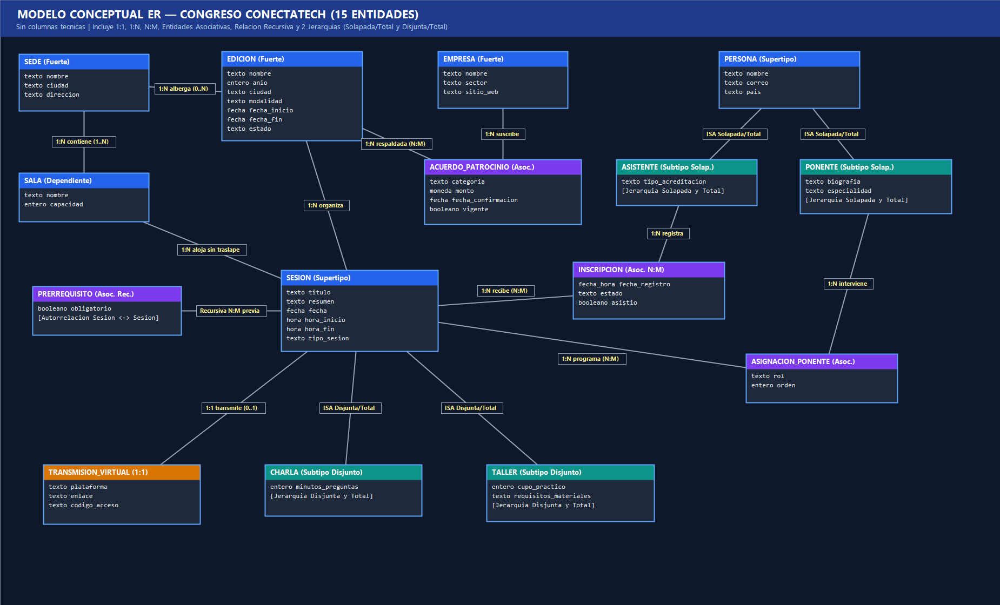
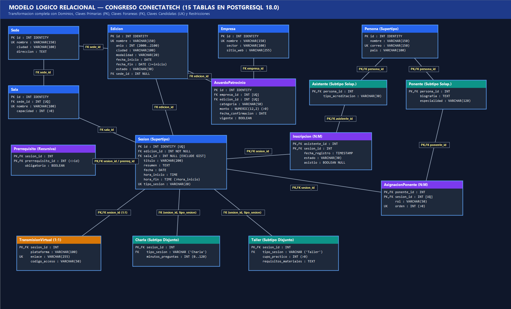

<div align="center">

# 🗄️ S7 — De la Narrativa al Modelo Relacional Avanzado
### Congreso ConectaTech · Sistema de Gestión de Congresos Profesionales

[](https://www.postgresql.org/)
[](https://docs.docker.com/compose/)
[](https://mermaid.js.org/)

> Análisis de narrativa de negocio, modelo entidad-relación conceptual y lógico en Mermaid, y esquema relacional ejecutable en **PostgreSQL 18.0** con validación declarativa de integridad.

</div>

---

## 📋 Tabla de Contenidos

- [Descripción del Dominio](#-descripción-del-dominio)
- [Estructura del Repositorio](#-estructura-del-repositorio)
- [Modelo Conceptual (ER)](#-modelo-conceptual-er)
- [Modelo Lógico Relacional](#-modelo-lógico-relacional)
- [Reproducibilidad con Docker Compose](#-reproducibilidad-con-docker-compose)
- [Reglas de Negocio y Restricciones](#-reglas-de-negocio-y-restricciones)
- [Pruebas de Operaciones Inválidas](#-pruebas-de-operaciones-inválidas)
- [Video de Demostración](#-video-de-demostración)

---

## 📌 Descripción del Dominio

**ConectaTech** organiza congresos profesionales **presenciales, virtuales e híbridos** en distintas ciudades. Esta solución modela y protege íntegramente el dominio en **PostgreSQL 18.0** sin usar ORMs ni generadores automáticos:

| Característica | Implementación en el Proyecto |
|---|---|
| 🏗️ **15 Tablas Relacionales** | `Sede`, `Edicion`, `Sala`, `Persona`, `Asistente`, `Ponente`, `Sesion`, `Charla`, `Taller`, `TransmisionVirtual`, `Prerrequisito`, `Inscripcion`, `AsignacionPonente`, `Empresa`, `AcuerdoPatrocinio` |
| 🔗 **Relaciones Completas** | **1:1** (`Sesion`–`TransmisionVirtual`), **1:N** (`Sede`–`Sala`, `Sede`–`Edicion`, `Edicion`–`Sesion`, `Sala`–`Sesion`), **N:M** (`Inscripcion`, `AsignacionPonente`, `AcuerdoPatrocinio`) y **Recursiva** (`Prerrequisito`) |
| 🌲 **Dos Jerarquías** | **Solapada y Total**: `Persona` → `Asistente` / `Ponente` · **Disjunta y Total**: `Sesion` → `Charla` / `Taller` |
| 🛡️ **Integridad en Motor** | `GENERATED ALWAYS AS IDENTITY`, `PRIMARY KEY`, `FOREIGN KEY`, `UNIQUE`, `CHECK`, `DEFAULT`, `NOT NULL` y `EXCLUDE USING gist` (sin solapamiento de horarios en salas) |

---

## 📁 Estructura del Repositorio

```text
s7-modelo-relacional-avanzado/
├── README.md                  ← Documentación principal y guía de reproducibilidad
├── narrativa-y-reglas.md      ← Análisis del dominio, supuestos, decisiones y 14 reglas de negocio
├── diccionario-datos.md       ← Diccionario completo de las 15 tablas y justificación del modelo lógico
├── compose.yaml               ← Servicio Docker Compose con imagen explícita postgres:18.0
├── .env.example               ← Plantilla de variables de entorno (sin contraseñas reales en Git)
├── .gitignore                 ← Exclusión de .env y volúmenes locales
├── modelo-conceptual.mmd      ← Fuente Mermaid del diagrama ER conceptual (sin columnas técnicas)
├── modelo-logico.mmd          ← Fuente Mermaid del modelo lógico relacional (15 tablas con PK/FK/UK)
├── diagrama-conceptual.png    ← Vista exportada del modelo conceptual
├── diagrama-logico.png        ← Vista exportada del modelo lógico
├── index.html                 ← Reporte ejecutivo para exportación a PDF (Entregable Canvas)
└── sql/
    ├── 01_schema.sql          ← Creación limpia de las 15 tablas y sus restricciones
    ├── 02_seed.sql            ← Datos semilla (2 ediciones, 6 personas, 6 sesiones, 8 inscripciones, 4 ponencias, 3 patrocinios)
    ├── 03_queries.sql         ← 5 consultas multi-tabla (programa, cupos, participación, jerarquías, patrocinios)
    └── 04_invalid_tests.sql   ← 8 operaciones inválidas rechazadas por PostgreSQL 18.0
```

---

## 🗺️ Modelo Conceptual (ER)

Elaborado en [modelo-conceptual.mmd](modelo-conceptual.mmd) sin columnas técnicas. Incluye todas las entidades del dominio, entidades asociativas, relación recursiva y las dos jerarquías requeridas:

- **Jerarquía Solapada y Total (`Persona` → `Asistente` / `Ponente`)**: Una persona puede ser asistente, ponente o ambos en una edición, y debe desempeñar al menos un rol.
- **Jerarquía Disjunta y Total (`Sesion` → `Charla` / `Taller`)**: Toda sesión es exactamente una charla o un taller, nunca ambos.



---

## 📐 Modelo Lógico Relacional

Elaborado en [modelo-logico.mmd](modelo-logico.mmd) y documentado en [diccionario-datos.md](diccionario-datos.md). Representa las **15 tablas** con sus dominios, claves primarias (`PK`), claves foráneas (`FK`) y claves candidatas (`UK`):



---

## 🚀 Reproducibilidad con Docker Compose

### 1️⃣ Clonar el repositorio

```bash
git clone https://github.com/RobertGameros/S7-Modelo-Relacional-Avanzado..git
cd S7-Modelo-Relacional-Avanzado.
```

### 2️⃣ Crear el archivo `.env` desde la plantilla

```bash
cp .env.example .env
# Edite .env con su contraseña local (p. ej. POSTGRES_USER=ROBERT y POSTGRES_PASSWORD=...)
```

### 3️⃣ Iniciar PostgreSQL 18.0 desde una base vacía

```bash
docker compose up -d
```

### 4️⃣ Ejecutar los scripts en orden (Creación, Carga, Consultas y Validación de Restricciones)

```bash
# 1. Crear esquema (15 tablas y restricciones)
docker exec -i conectatech_db psql -U ROBERT -d conectatech < sql/01_schema.sql

# 2. Cargar datos semilla
docker exec -i conectatech_db psql -U ROBERT -d conectatech < sql/02_seed.sql

# 3. Ejecutar consultas de validación del programa, cupos y participación
docker exec -i conectatech_db psql -U ROBERT -d conectatech < sql/03_queries.sql

# 4. Demostrar el rechazo de estados imposibles (debe reportar ERROR en cada prueba inválida)
docker exec -i conectatech_db psql -U ROBERT -d conectatech < sql/04_invalid_tests.sql
```

### 5️⃣ Reiniciar la solución desde una base completamente vacía

```bash
docker compose down -v
docker compose up -d
```

---

## 📏 Reglas de Negocio y Restricciones

Documentadas en detalle en [narrativa-y-reglas.md](narrativa-y-reglas.md):

| Código | Regla de Negocio | Origen | Restricción en PostgreSQL 18.0 |
|---|---|---|---|
| **RN-01** | La fecha final de una edición no puede ser anterior a su fecha inicial | Explícito | `CHECK (fecha_fin >= fecha_inicio)` |
| **RN-02** | Edición presencial/híbrida exige sede; edición virtual no usa sede física | Explícito | `CHECK (chk_edicion_sede_modalidad)` |
| **RN-03** | El correo electrónico de cada persona es obligatorio y único | Explícito | `NOT NULL UNIQUE CHECK (correo LIKE '%_@_%.__%')` |
| **RN-04** | Toda persona desempeña rol de Asistente, Ponente o ambos | Explícito | Jerarquía solapada (`Asistente`, `Ponente` con `PK=FK`) |
| **RN-05** | Toda sesión se clasifica exactamente como `Charla` o `Taller` | Explícito | `CHECK (tipo_sesion IN ('Charla','Taller'))` + FK compuesta `(sesion_id, tipo_sesion)` |
| **RN-06** | La hora final de una sesión es posterior a su hora inicial | Explícito | `CHECK (hora_fin > hora_inicio)` |
| **RN-07** | Una sala no aloja dos sesiones cuyos horarios se superpongan | Explícito | `EXCLUDE USING gist (sala_id WITH =, tsrange(...) WITH &&)` |
| **RN-08** | Una sesión tiene como máximo una transmisión virtual (1:1) | Decisión propia | `TransmisionVirtual (sesion_id PRIMARY KEY REFERENCES Sesion(id))` |
| **RN-09** | Ninguna sesión puede ser prerrequisito de sí misma | Explícito | `CHECK (sesion_id <> prerrequisito_id)` |
| **RN-10** | No puede existir dos veces la misma inscripción de un asistente a una sesión | Explícito | `PRIMARY KEY (asistente_id, sesion_id)` |
| **RN-11** | Dos ponentes no pueden compartir el mismo orden en la misma sesión | Supuesto | `UNIQUE (sesion_id, orden)` |
| **RN-12** | Solo debe existir un acuerdo vigente por empresa patrocinadora y edición | Explícito | `UNIQUE (empresa_id, edicion_id)` |

---

## ❌ Pruebas de Operaciones Inválidas (`sql/04_invalid_tests.sql`)

| # | Categoría Requerida | Operación Inválida Probada | Restricción que Rechaza | Mensaje de Error en PostgreSQL |
|---|---|---|---|---|
| **1** | **Duplicado** | Inscribir a `asistente_id=1` por segunda vez en `sesion_id=1` | `PRIMARY KEY (asistente_id, sesion_id)` | `duplicate key value violates unique constraint "inscripcion_pkey"` |
| **2** | **FK inexistente** | Crear sesión apuntando a `sala_id=999` | `FOREIGN KEY (sala_id)` | `insert or update on table "sesion" violates foreign key constraint "sesion_sala_id_fkey"` |
| **3** | **Valor fuera de dominio** | Crear edición con `fecha_fin < fecha_inicio` | `CHECK (chk_edicion_fechas)` | `new row for relation "edicion" violates check constraint "chk_edicion_fechas"` |
| **4** | **Dato obligatorio ausente** | Insertar `Persona` con `correo = NULL` | `NOT NULL (correo)` | `null value in column "correo" of relation "persona" violates not-null constraint` |
| **5** | **Autorrelación inválida** | Asignar `sesion_id=1` como prerrequisito de sí misma (`1 -> 1`) | `CHECK (chk_prerrequisito_no_recursivo)` | `new row for relation "prerrequisito" violates check constraint "chk_prerrequisito_no_recursivo"` |
| **6** | **Violación adicional (UK)** | Segundo acuerdo de patrocinio para `empresa_id=1` y `edicion_id=1` | `UNIQUE (uq_acuerdo_empresa_edicion)` | `duplicate key value violates unique constraint "uq_acuerdo_empresa_edicion"` |
| **7** | **Solapamiento de sala** | Programar otra sesión en `sala_id=1` el `2026-10-10` de `09:30` a `11:00` | `EXCLUDE USING gist (excl_sala_sin_traslape)` | `conflicting key value violates exclusion constraint "excl_sala_sin_traslape"` |
| **8** | **Jerarquía disjunta** | Registrar la Sesión 1 (`Charla`) en la tabla `Taller` | `FOREIGN KEY (fk_taller_sesion)` | `insert or update on table "taller" violates foreign key constraint "fk_taller_sesion"` |

---

## 🎬 Video de Demostración

- **Enlace de lectura al video (máx. 3 minutos):** [Ver Demostración en Google Drive](https://drive.google.com/drive/folders/1rsT8FCPpZ7aiTyq1t3qWWwalcTQky-Z4?usp=sharing)
- **Repositorio Público:** [https://github.com/RobertGameros/S7-Modelo-Relacional-Avanzado.](https://github.com/RobertGameros/S7-Modelo-Relacional-Avanzado.)
